# KeybowNotes

A 16-key macro pad and a Mac menu-bar app that turn two or three key presses into
a note, a calendar event, a message, a snippet of text typed where you are, a
lamp switched on — or a question to Claude.

The keypad is a [Pimoroni Keybow 2040](https://shop.pimoroni.com/products/keybow-2040)
or a Raspberry Pi Pico on Pimoroni's [RGB Keypad Base](https://shop.pimoroni.com/products/pico-rgb-keypad-base):
a 4 × 4 grid of lit keys. You arrange what you want to do as a tree, four keys to
a row. Pressing a key picks a branch; its choices light up on the next row, and a
heads-up display on the Mac shows where you are. Choosing a leaf runs its action.

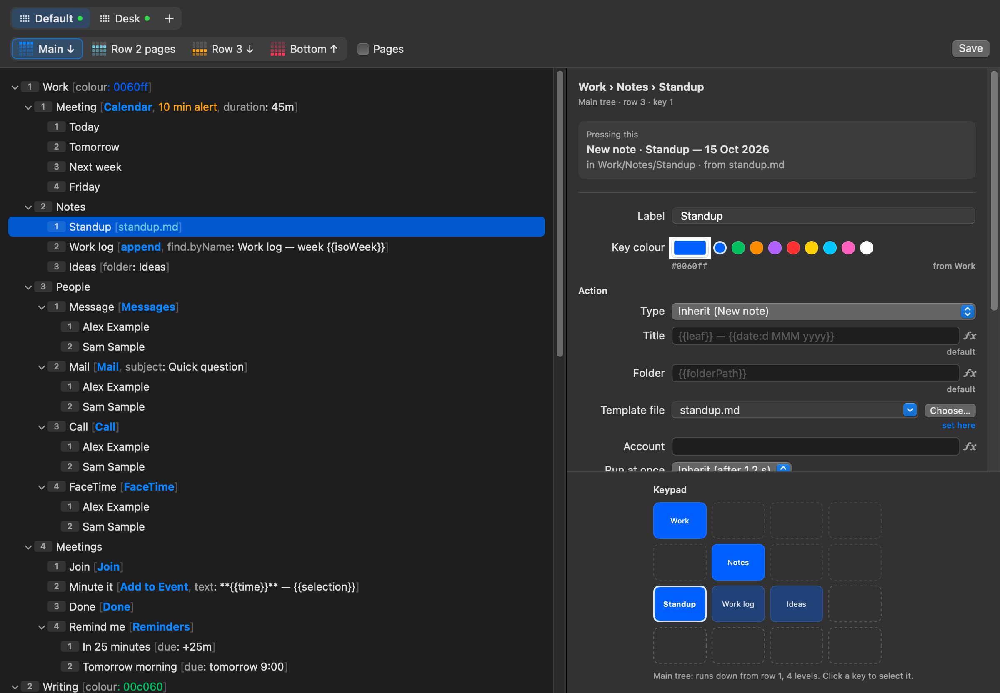

The tree is a plain outline file. *Work → Meeting → Tomorrow* makes a calendar
event called "Meeting" for tomorrow at 9:00, with an alert, and opens it ready to
edit; *Work → Notes → Standup* makes a note from a template:

```
1. Work [colour: 0060ff]
   1. Meeting [Calendar, 10 min alert, duration: 45m]
      1. Today
      2. Tomorrow
      3. Next week
      4. Friday
   2. Notes
      1. Standup [standup.md]
      2. Work log [append, find.byName: "Work log — week {{isoWeek}}"]
      3. Ideas [folder: Ideas]
```

Every picture here is of one made-up tree,
[docs/examples/showcase.md](docs/examples/showcase.md), which has a key of every
kind — copy what you like into your own.

- [The heads-up display](#the-heads-up-display)
- [What a key can do](#what-a-key-can-do): [notes and events](#notes-calendar-and-reminders),
  [people](#people), [meetings](#meetings), [text](#text-where-you-are),
  [Claude](#ask-claude), [displays and questions](#on-screen-display-and-ask),
  [apps, music and timers](#apps-links-music-and-timers),
  [windows and the Mac](#windows-and-the-macs-own-controls),
  [your home](#home-assistant), [values from APIs](#values-from-apis)
- [Values](#values), [four trees, pages and several keypads](#four-trees-pages-and-several-keypads)
- [The tree editor](#the-tree-editor), [Design with Claude](#design-with-claude),
  [from other apps and AI agents](#from-other-apps-and-ai-agents)
- [Getting started](#getting-started)

## The heads-up display

While you choose, the HUD follows along: the path so far, the choices on offer,
and a copy of what the keys are showing. When you reach a leaf there's a moment to
change your mind — press any key — before the action runs.

| Choosing | About to run |
|---|---|
| 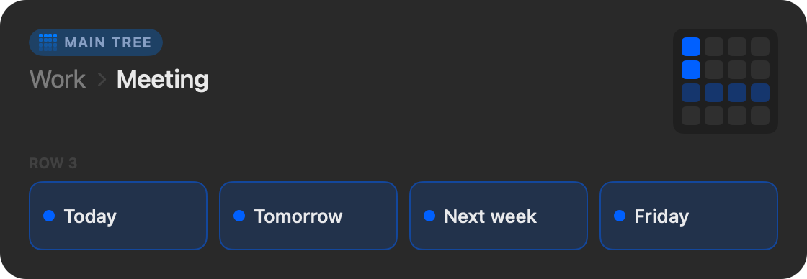 | 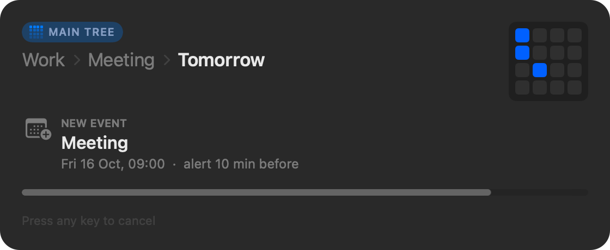 |
| **People, from the tree's contacts** | **A dry run: shown, not done** |
| 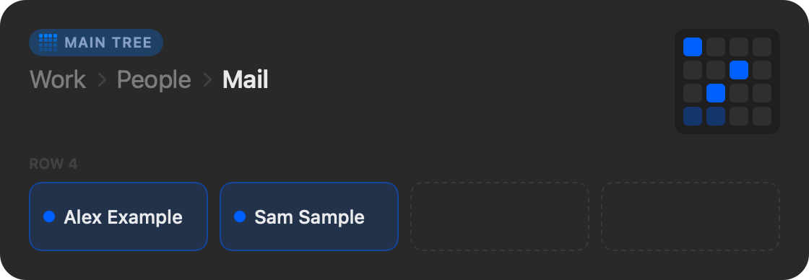 |  |

*Dry Run*, in the menu bar, shows what each key would do without doing it — for
trying a tree out safely.

## What a key can do

Each leaf does one thing, usually named by a word in square brackets that the
leaves under it inherit. The tree editor's *Type* menu lists them all, with every
field explained; [docs/CONFIG-LANGUAGE.md](docs/CONFIG-LANGUAGE.md) describes
each one.

### Notes, calendar and reminders

- **Notes**: a new note, filed in folders that mirror the tree, or an entry added
  to a running note — a work log, a monthly check-in. Templates in Markdown
  become Notes formatting.
- **Calendar and Reminders**: events and reminders from plain dates — *today*,
  *tomorrow 14:00*, *friday*, *+25m* — with alerts; a reminder due in 25 minutes
  makes a handy timer.

```
4. Meetings
   4. Remind me [Reminders]
      1. In 25 minutes [due: +25m]
      2. Tomorrow morning [due: tomorrow 9:00]

# bottom
1. Check-in [colour: 00c8c8, append, find.byName: "Check-ins — {{date:MMMM yyyy}}", folder: Journal]
   1. Mood [@rating]
   2. Energy [@rating]
   3. Focus [@rating]

# list rating
1. Great
2. Good
3. Meh
4. Rough
```

`[@rating]` gives a branch the same four choices as any other that uses the list.

### People

**Messages and Mail** open a message or an email ready to send — never sent for
you. **Call** rings through your iPhone, and **FaceTime** makes an audio call;
macOS asks you to confirm either. People come from the tree's own `# contacts`.

```
3. People
   1. Message [Messages]
      1. Alex Example
      2. Sam Sample
   2. Mail [Mail, subject: "Quick question"]
      1. Alex Example
      2. Sam Sample
   3. Call [Call]
   4. FaceTime [FaceTime]

# contacts
- Alex Example [phone: +15550100, email: alex@example.com]
- Sam Sample [phone: +15550101, email: sam@example.com]
```

### Meetings

**Join** opens the video call of the meeting under way — Zoom, Meet, Teams,
Webex and more — from the link in the event. **Add to Event** adds a line to its
notes, and **Done** ticks off the reminder due next. The meeting's title, time
and attendees, and the rest of the day's agenda, are values any key can use:
`{{event}}`, `{{agenda}}`, `{{reminder}}`.

```
4. Meetings
   1. Join [Join]
   2. Minute it [Add to Event, text: "**{{time}}** — {{selection}}"]
   3. Done [Done]
```

### Text where you are

**Insert** types text at the cursor in whatever app you're using, by pasting;
**Direct Insert** does it without touching the clipboard; **Copy** puts it on the
clipboard. Markdown goes on formatted, so it pastes as headings, lists and
tables into Mail, Notes or Pages.

```
4. Snippets [Copy]
   1. Kind regards
   2. Address [text: "1 High Street\nSmalltown"]
   3. Today [text: "{{date:d MMMM yyyy}}"]
   4. Unpaid [unpaid.md]
```

A template can go through rows — cells copied from a spreadsheet, a CSV file, an
API's results — with `{{#each}}`. *Unpaid* turns the invoices you've copied in
Numbers or Excel into a table of the ones still owed, with a total:

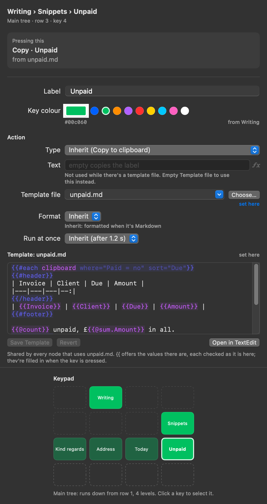

### Ask Claude

A template can hold `{{#ai}}…{{/ai}}` blocks. The text inside is filled in and
sent to Claude, and the reply takes the block's place. `{{selection}}` is the
text selected in the app you're using, so these keys rewrite whatever you've
highlighted:

```
2. Writing [colour: 00c060]
   1. Summarise [Insert, text: "{{#ai}}Summarise in one line: {{selection}}{{/ai}}"]
   2. Tidy up [Direct Insert, text: "{{#ai}}Fix the spelling and grammar, changing nothing else: {{selection}}{{/ai}}"]
   3. Quote it [Insert, text: "“{{selection}}”"]
```

| The key | While Claude answers |
|---|---|
| 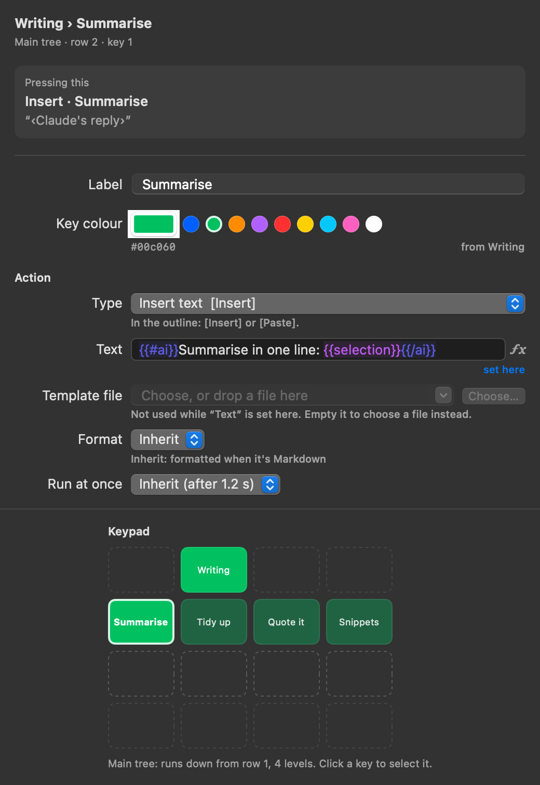 | 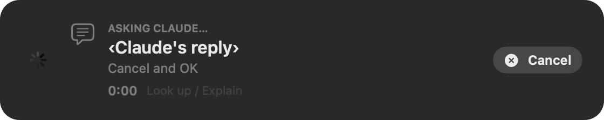 |

Blocks nest, and those side by side are asked at once. While you wait, the HUD
shows a timer and a Cancel button. Blocks aren't allowed where a reply could decide
where an action goes — links, phone numbers, apps — so text you select can't steer
it there. Claude Opus 5.5 at low effort by default; your API key stays in the
Keychain.

Copy a screenshot, an image or a PDF, and `{{clipboard}}` sends it to Claude as
itself — *What does this error mean? {{clipboard}}*. Settings → Privacy says what
a block may send: untick the selected text, the clipboard, its images and PDFs,
where you are, or your meetings and reminders, and a key that would send it
refuses before anything is read.

### On screen: Display and Ask

**Display** shows a template or text in a panel sized to fit — Markdown or HTML —
that fades by itself, or waits for OK or Cancel. Each button can run an action of
its own. *Explain* shows Claude's answer, and OK files it as a note:

```
3. Look up [colour: ff8c00]
   1. Explain [Display, text: "{{#ai}}Explain briefly: {{selection}}{{/ai}}", button: okCancel, ok: Notes, ok.folder: Explained, ok.title: "{{selection}}"]
   4. Quote [Display, text: "{{quote file=quotes.md}}", fade: 20 sec]
```

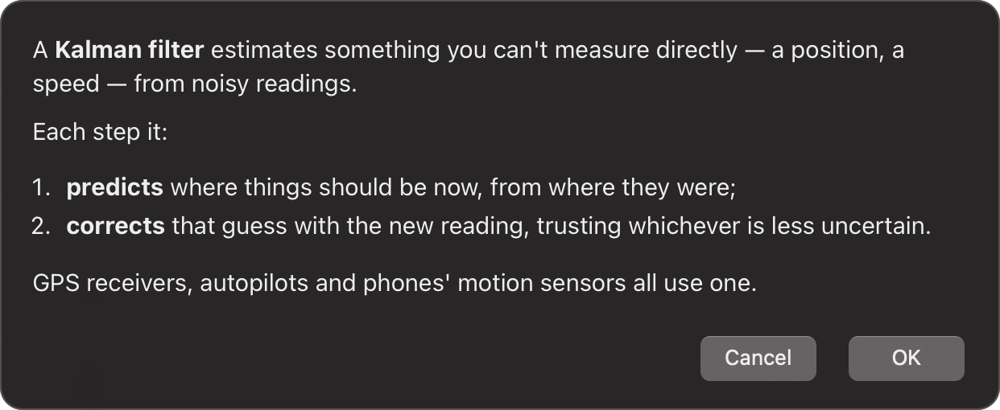

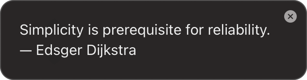

`{{quote file=quotes.md}}` picks a list item or paragraph from a file — at
random, or each in turn — for a quote of the day, a writing prompt or the next
thing on a reading list.

**Ask** shows a question with a field to type in, and hands the answer, as
`{{answer}}`, to an action of your choosing — a search, a note, text typed where
you were:

```
2. Search [Ask, text: "Search the web for", initial: "{{selection|}}", ok: Link, ok.url: "https://duckduckgo.com/?q={{answer}}"]

# bottom
2. Capture [colour: ffd000]
   2. Jot [Ask, text: "A note for the inbox", multiline: true, ok: append, ok.find.byName: Inbox, ok.entry: "{{answer}}"]
```

| Asking | The key, in the editor |
|---|---|
| 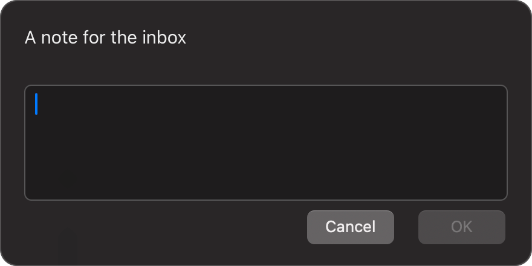 | 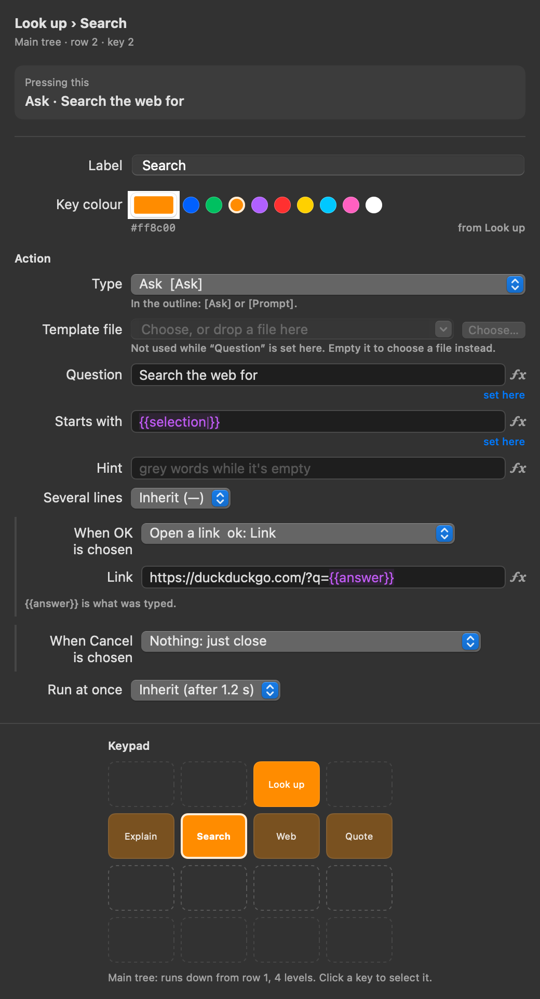 |

The editor shows a display's or an Ask's OK and Cancel actions under it, each with
its own type and fields:

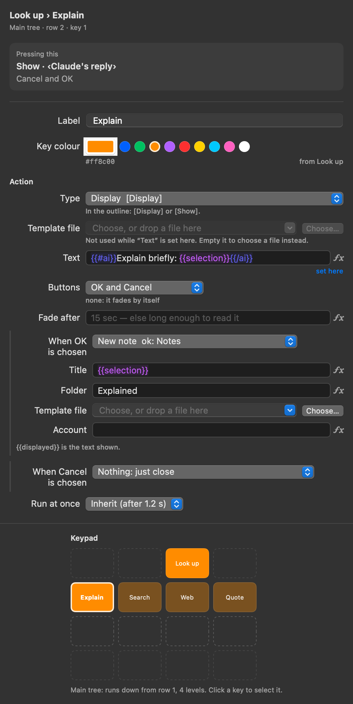

### Several actions on one key

Bullets under a key are its steps, run one after another — each inherits the
key's settings, so it only needs what's different. A step can be a condition,
`If {{answer}} is yes`, with the steps it guards under it; an Ask's answer, or a
display's OK, is there for the steps after it:

```
1. Standup [Calendar, title: Standup, start: tomorrow 9:30, duration: 15m]
   - The event
   - Notes for it [Notes, folder: Standups]
2. Jot [colour: ffb000, Ask, text: "What's on your mind?"]
   - Ask
   - If {{answer}} contains tomorrow
      - Remind me [Reminders, title: "{{answer}}", due: tomorrow]
   - Else
      - File it [append, find.byName: Inbox, entry: "{{answer}}"]
```

In the editor, ⇧Return adds a step to the selected key, and an If's *Add Else*
adds the steps for when it doesn't hold. *Pressing this* lists what the key will
run, in turn:


### Apps, links, music and timers

- **Apps, files and links**: open an app, a file in an app, a web page, or any
  app's own link — a Discord channel, a Things project.
- **Shortcuts**: run any shortcut, with text as its input.
- **Maps**: search for the key's label, or the selected text.
- **Music**: play a playlist, an album, an artist, a genre or a song from your
  library, shuffled or in order.
- **Timer**: start a timer in Clock.
- **Stopwatch**: KeybowNotes' own — start, stop, lap and reset from the keys. It
  shows in the HUD and the menu bar, its key breathes while it runs, and its time
  is a value: a show note can be stamped with it.

```
4. Play [colour: b060ff]
   1. Music [Music]
      1. Focus
      2. Party [shuffle: true]
      3. Kind of Blue [album: Kind of Blue, artist: Miles Davis]
   2. Timer [Timer]
      1. 5 Minutes
      2. 25 Minutes
      3. Tea [duration: 4 min]
   3. Stopwatch [Stopwatch]
      1. Start
      2. Stop
      3. Lap
      4. Reset
   4. Open
      1. Terminal [type: app.open, app: Terminal]
      2. Website [type: app.open, app: TextEdit, open: ~/Code/website/README.md]
      3. Morning [type: shortcut, name: Morning routine]
      4. Inbox [things:///show?id=inbox]
```

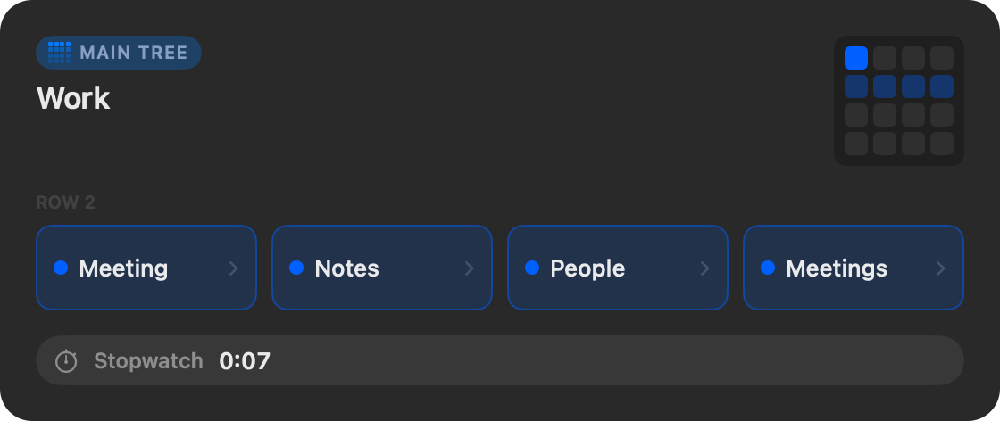

### Windows and the Mac's own controls

**Window** puts the window you're working in on a half or a quarter of the
screen, fills it, or sends it to another screen. **Exposé** shows every window,
the app's, or the desktop. **Spaces** shows a chosen desktop on each screen —
one key for Claude on the left, the editor in the middle and the docs on the
right — each screen's choice inherited down the tree on its own. And the Mac's own controls: **Volume**, the
**Microphone** (muted for every app), **Brightness** — Apple's screens and, on an
Intel Mac, monitors over DDC — **Wi‑Fi**, **Bluetooth**, **Night Shift**,
**Dark Mode**, **Stay Awake** and **Focus**.

Keys like these suit [pages](#four-trees-pages-and-several-keypads): each key on
row 2 picks a page, and the rows below become its keys, each doing its one thing
the moment it's pressed.

```
# row 2 [pages]
1. Windows [colour: f0a020, Window]
   1. Left
   2. Right
   3. Top left
   4. Top right
   5. Full
   6. Next screen
   7. Bottom left
   8. Bottom right
2. Mac [colour: 40a0ff]
   1. Louder [Volume]
   2. Quieter [Volume]
   3. Mute [Volume]
   4. Mic [Microphone]
   5. Brighter [Brightness]
   6. Dimmer [Brightness]
   7. Night Shift [Night Shift]
   8. Dark [Dark Mode]
3. More [colour: 9070ff]
   1. Wi-Fi [Wi-Fi]
   2. Bluetooth [Bluetooth]
   3. Awake [Stay Awake]
   4. Bedtime [Focus]
   5. All windows [Exposé]
   6. App windows [Exposé]
   7. Desktop [Exposé]
```

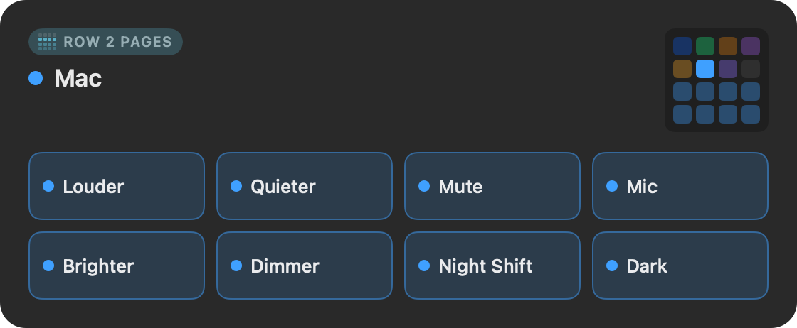

| Windows | Mac | More |
|---|---|---|
| 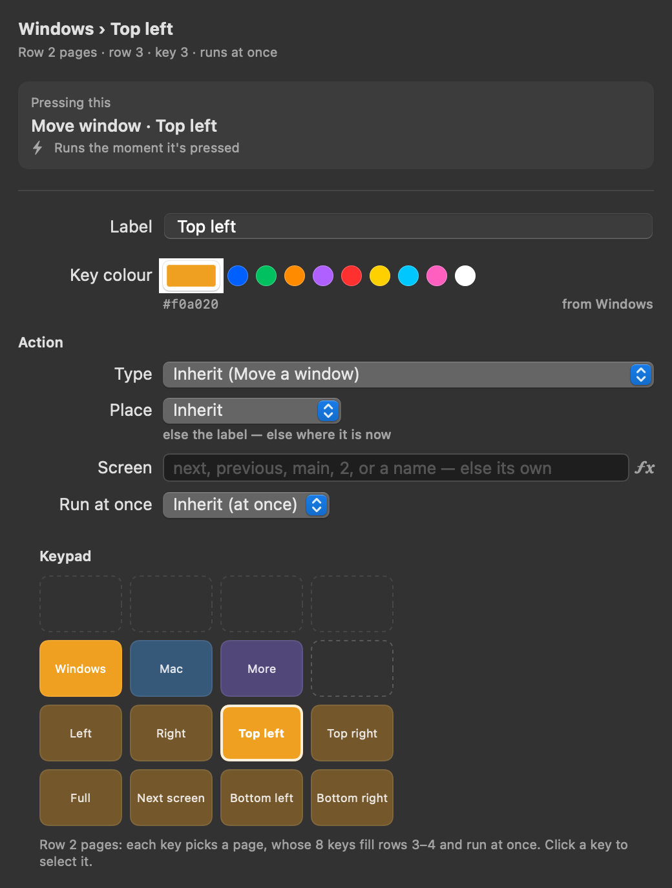 | 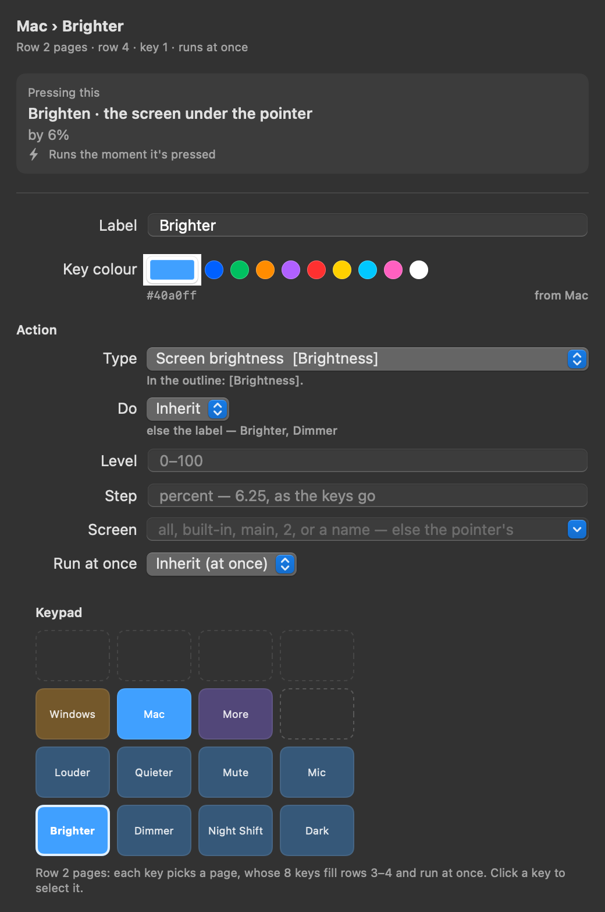 | 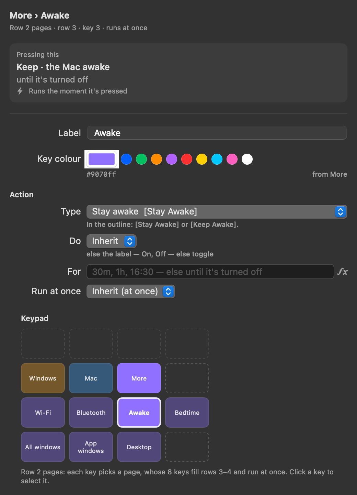 |

### Home Assistant

Switch and dim lamps, set the heating, run scenes — and any entity's state is a
value: *It's 14.2 °C outside*. In the editor, *Entity* lists what Home Assistant
has, and only the fields that entity takes are shown.

```
# row 3
1. Home [colour: ff40c0, Home]
   1. Desk lamp [entity: light.desk_lamp]
   2. Reading [entity: light.desk_lamp, brightness: 40, kelvin: 2700]
   3. Warmer [entity: climate.hallway, temperature: 21.5]
   4. Evening [entity: scene.evening]
2. Outside [colour: 30c0ff, Display, text: "It's {{home.sensor.outdoor_temperature.text|unknown}} outside"]
```

| The key | The value |
|---|---|
| 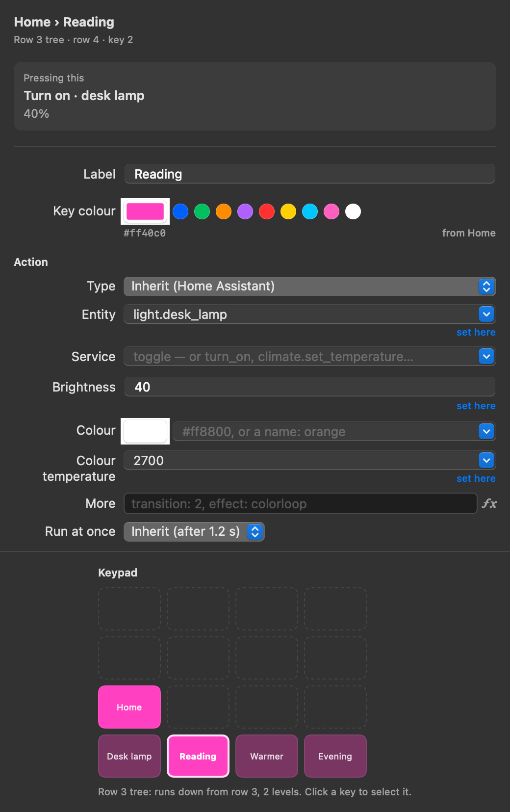 | 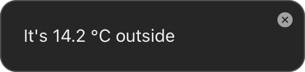 |

The token stays in the Keychain, and is sent only to your Home Assistant.

### Values from APIs

Bring a live value from a web API into whatever a key writes or opens: the
temperature, an exchange rate, the next train, a parcel's status. In
*Data Sources*, from the menu bar, give the API's address and its key if it needs
one, then describe the value you want in your own words — *today's sunset time where
I am*. Claude reads a sample of the response and writes a rule that finds the value —
a JSONPath, an XPath or a regular expression — which the app tries on the sample
before showing you what it finds.

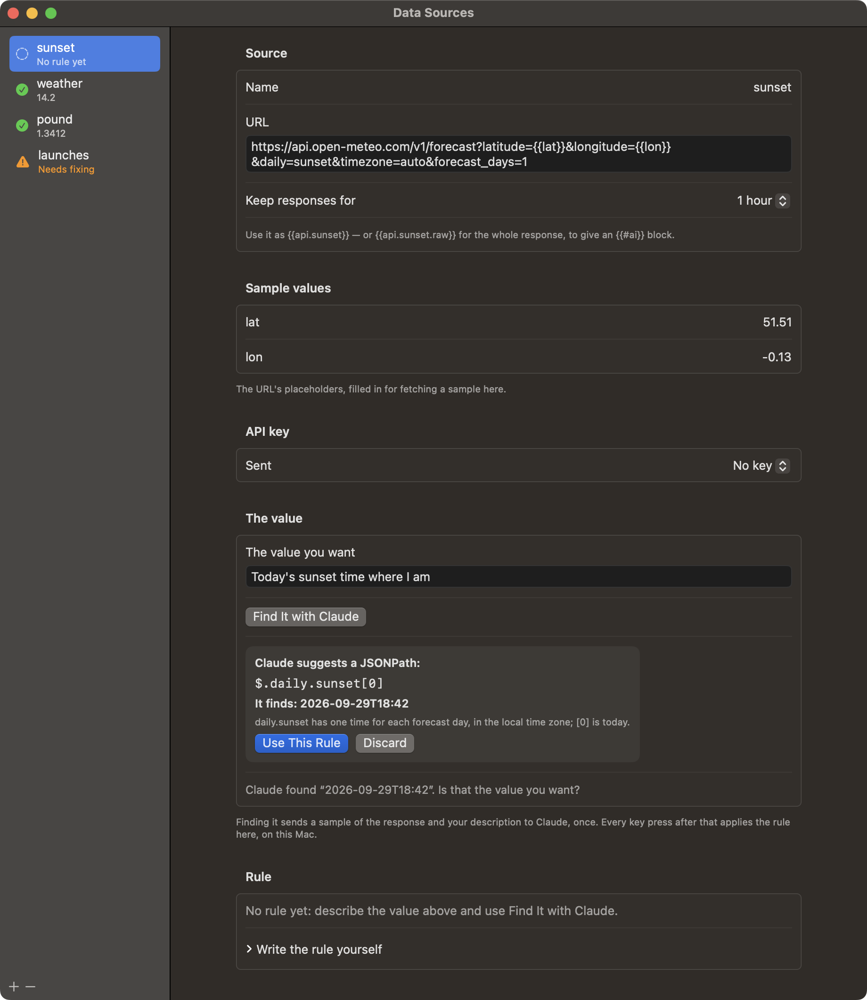

That's the only time Claude is asked. From then on, each key press fetches the API
and applies the rule on your Mac — no model in the loop, and responses kept for as
long as you choose:

```
1. Outside [lat: 51.51, lon: -0.13]
   1. Sunset [Insert, text: "Sunset today: {{api.sunset}}"]
```

The URL's placeholders — `{{lat}}` and `{{lon}}` here — come from the tree, like any
other value. Use `{{location.latitude}}` and `{{location.longitude}}` in the URL
instead, and the source follows your laptop about. A fetched value may go in a link or a phone number, since a fixed rule
picks it, not a model. If the API changes and the rule stops finding its value, the
key says so, the menu bar flags the source, and Claude can find it again from your
description. API keys stay in the Keychain and go only to their own API.

## Values

Anything an action writes can include `{{placeholders}}`:

| | |
|---|---|
| `{{leaf}}`, `{{parent}}`, `{{level2}}` | the labels along the path |
| `{{contact.phone}}`, `{{project.path}}` | from the tree's contacts and projects |
| `{{date:d MMMM yyyy}}`, `{{time}}`, `{{isoWeek}}` | the date in any format |
| `{{selection}}`, `{{clipboard}}` | the text selected in the app you're using, and the clipboard |
| `{{location}}` | where your Mac is |
| `{{event}}`, `{{agenda}}`, `{{reminder}}` | your meetings and reminders |
| `{{quote file=…}}`, `{{file name=…}}` | a portion of a file, or all of it |
| `{{home.…}}`, `{{api.…}}` | Home Assistant, and data sources |
| `{{stopwatch}}` | the stopwatch's time |
| `{{#each …}}…{{/each}}`, `{{#ai}}…{{/ai}}` | rows, and Claude |

A fallback after a `|` stands in when a value is missing: `{{selection|}}`,
`{{clipboard|Task}}`. In the editor, `{{` offers the values there are, and *ƒx*
beside a field browses them, each with an example.

## Four trees, pages and several keypads

**Four trees** — the row you press first chooses the tree: row 1 runs down through
all four rows, rows 2 and 3 are shorter trees of their own, and row 4 runs upwards.
Four menus on one keypad, with the top row always a way back to the main one.

**Pages** — the main, row 2 or row 3 tree can be pages instead, as on a macro
pad: each key on its row picks a page, which stays, and the rows below become
that page's keys, lit in its colour, each doing its one thing the moment it's
pressed. A key on a row above goes back to the trees. `# row 2 [pages]` in the
outline, or the *Pages* checkbox in the editor.

**Several keypads** — plug in more than one, and each can have trees of its own:
a `# keypad Desk [RGB Keypad]` section of the outline, chosen by model or by the
board's unique ID, and a tab of its own in the tree editor. Without one, every
keypad shares the same trees.

```
# keypad Desk [RGB Keypad]
1. Stopwatch [colour: ff6030, Stopwatch]
   1. Start
   2. Stop
   3. Lap
   4. Reset
2. Windows [colour: f0a020, Window]
   1. Left
   2. Right
   3. Full
   4. Next screen
```

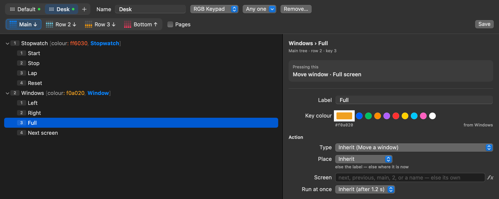

## The tree editor

The tree is a plain outline file, `tree.md`, and the editor is an outliner for it:
Return, Tab and Shift-Tab to add and arrange nodes, a settings pane with a tooltip
on every field, and the keypad drawn as it will light up. *Pressing this* at the
top says what the selected key will do, with the values it'll use. Nodes cut,
copy and paste — several at once, between trees and keypads — as outline text.
Colours, templates, contacts and values are all set there, and anything a node
has that does nothing is flagged, with a button to remove it. Every setting says
where it comes from — set here, inherited from a branch, or the default.

Fields that take values colour them as you type, complete them after `{{`, and
say when one is misspelt; a template can be edited in place. See
[docs/TREE-EDITOR.md](docs/TREE-EDITOR.md).

**Modules** — the stopwatch, Claude blocks, data sources, location, quotes,
displays, Ask, window moving, Exposé, Spaces, meetings, Home Assistant and the Mac's own
controls are modules: separate code that plugs in through one interface, adding
actions, template blocks, values, settings and menu commands. See
[docs/MODULES.md](docs/MODULES.md).

## Design with Claude

*Design with Claude…*, from the menu bar, is a conversation about your keypads
beside the tree editor. Say what you'd like the keys for, in your own words, and
Claude's draft appears in the editor — a new keypad, or a redraft of one you
have. Click through it, try the tabs, change anything by hand, and ask for
changes as you would a person. Your tree changes only when you add the draft.

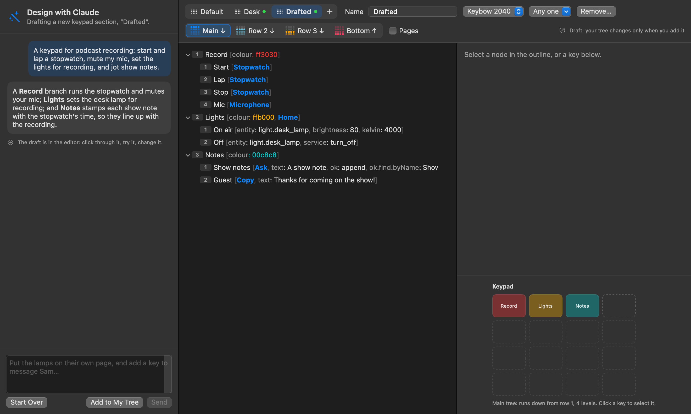

What goes with your request — your tree, the names of your apps and shortcuts,
your Home Assistant devices, as much of your Music library as you choose — is
ticked or not in Settings → Privacy.

## From other apps, and AI agents

KeybowNotes can be driven from outside as well as by its keys. **AppleScript**
and **Shortcuts** can run an entry as though its keys were pressed, add,
change and remove entries, read a tree, and start, stop and lap the
stopwatch. An **MCP server** gives AI agents — Claude Desktop, Claude Code —
the same, with a guide to designing trees and a checker for what they write.
See [docs/AUTOMATION.md](docs/AUTOMATION.md).

## How it fits together

- **[firmware/](firmware/)** — CircuitPython for the Keybow 2040 and the RGB
  Keypad. The keypad only reports key presses and shows the colours it's told
  to, over a USB serial port of its own.
- **[mac/](mac/)** — a Swift package: the menu-bar app, the tree editor, the core
  library, a `keybow` command-line tool, and the modules. Everything that decides
  what a key means lives here, on the Mac.
- **[docs/](docs/)** — the design, the configuration language, the editor, and
  the module interface.

## Requirements

- A **Pimoroni Keybow 2040**, or a **Raspberry Pi Pico** on Pimoroni's **RGB
  Keypad Base** — or several — running CircuitPython with Pimoroni's `pmk`
  library.
- A Mac with **macOS 15 Sequoia** or later — Apple silicon or Intel.
- **Xcode 16** or later to build it (Swift 6).
- Optional: an **Anthropic API key** for `{{#ai}}` blocks, data sources and
  *Design with Claude*; an **iPhone** on the same Apple Account for calls; and
  **Home Assistant** for your home.

## Getting started

1. **Install the app.** From a disk image (`KeybowNotes-….dmg`), drag
   KeybowNotes onto Applications. It isn't notarized, so the first time it's
   opened macOS blocks it: choose Done, then **Open Anyway** in System Settings →
   Privacy & Security. The note in the disk image says more.

   Or **build and install it** — from the `mac` folder:

   ```bash
   scripts/build-app.sh --install
   ```

   This builds a universal app, signs it with your Apple Development identity if
   you have one (so macOS remembers the permissions you grant), and copies it to
   `/Applications`. More in [mac/README.md](mac/README.md).
2. **Open KeybowNotes.** A keyboard icon appears in the menu bar, and the first
   launch installs an example tree in `~/Library/Application Support/KeybowNotes`.
3. **Set up the keypad** — plug it in and choose *Set Up a Keypad…* from the menu
   bar. It installs the newest CircuitPython the firmware supports, then the
   firmware, and restarts the keypad; any files it replaces are backed up first.
   `keybow setup` does the same from Terminal. To do it by hand instead, see
   [firmware/README.md](firmware/README.md).
4. **Make the tree your own** — choose *Edit Tree…* from the menu bar (⌘E), or
   *Design with Claude…*. The language is described in
   [docs/CONFIG-LANGUAGE.md](docs/CONFIG-LANGUAGE.md), and every field in the
   editor explains itself.
5. **Try things safely** — *Dry Run* in the menu shows what a key would do without
   doing it.

## When a keypad isn't found

*Set Up a Keypad…* brings in a troubleshooter by itself when no keypad turns up,
and *Find a Missing Keypad…* in the menu bar — or *Find It…* beside a missing
keypad in Settings — opens it any time. It works out what's wrong on its own, with
no AI or account needed: it reads what's plugged in and what macOS's USB log says
happened, watches while you unplug the keypad and plug it back in, and asks what
its keys are doing. Then it says what to do: a cable that only charges, a hub
that's given up and switched its ports off, a port another program has open, a
keypad in its bootloader or safe mode, firmware that needs a restart or
reinstalling. *Copy Report* puts everything it found on the clipboard, for anyone
helping.

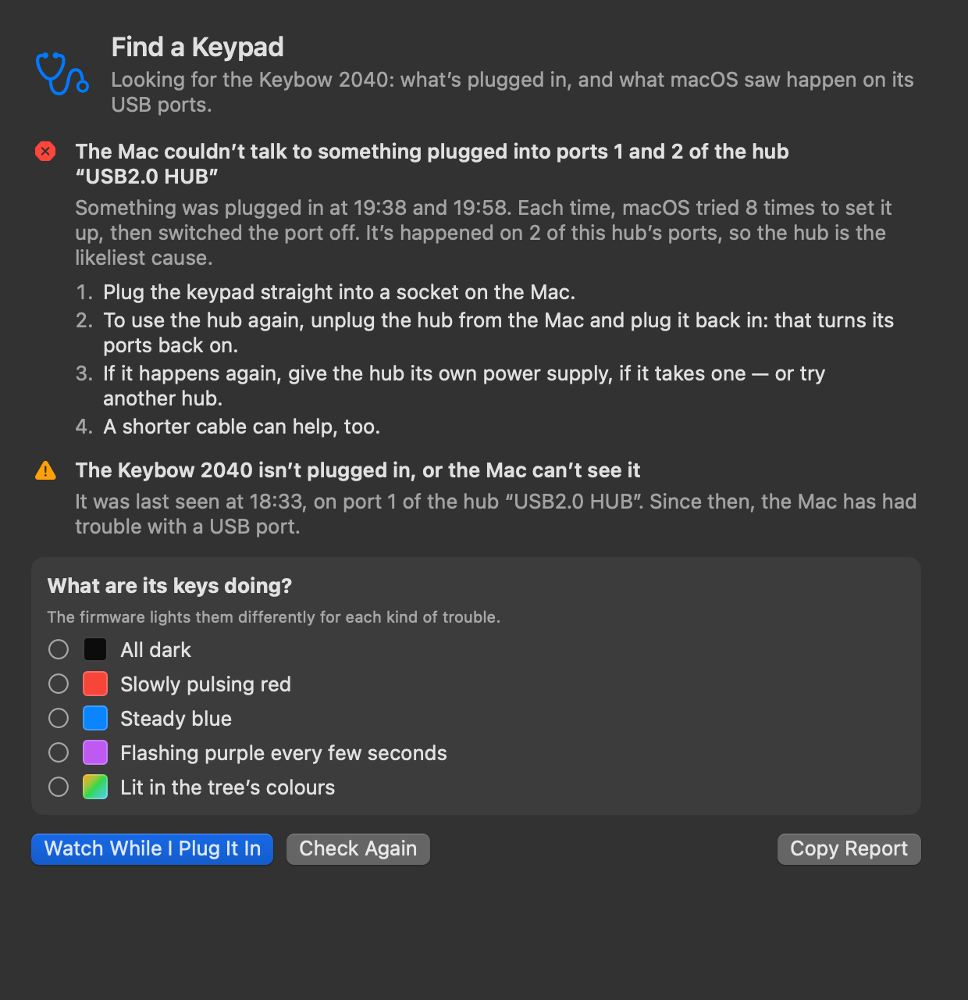

## Permissions and privacy

macOS asks the first time each is needed:

| For | Permission |
|---|---|
| Notes, Mail, Music | Automation — control of that app |
| Calendar events and reminders | Calendars, Reminders |
| `{{selection}}`, typing text into other apps, and moving windows | Accessibility |
| Looking people up in the editor | Contacts |
| `{{location}}`, where your Mac is | Location Services |
| Your Music library, for music keys | Media & Apple Music |
| Home Assistant on your network | Local Network |
| Setting a keypad up | Files on a removable volume: the keypad's drive |

**Settings → Privacy** has them all in one place: how each stands, a button to
ask now rather than mid-keypress, and a way to System Settings for one that's
been refused. Below them, it says what Claude is sent. For *Design with
Claude*: your tree file, the names of your apps and shortcuts, and your Home
Assistant devices, each ticked or not; and how much of your Music library
Claude may look through — nothing, its genres, its artists too, its albums
too, or every song — and whether your playlists' names go with it. Agents
reading the library through the MCP server see no more. For `{{#ai}}` blocks:
the selected text, the clipboard, images and PDFs on it, where you are, and
your meetings and reminders.

The app isn't sandboxed and isn't on the App Store: driving Notes, Mail and Music
through AppleScript rules that out.

## Documentation

- [docs/DESIGN.md](docs/DESIGN.md) — how it works, and why
- [docs/CONFIG-LANGUAGE.md](docs/CONFIG-LANGUAGE.md) — the tree, actions, values,
  templates and `{{#ai}}` blocks
- [docs/TREE-EDITOR.md](docs/TREE-EDITOR.md) — the editor, its keys and its panes
- [docs/MODULES.md](docs/MODULES.md) — the module interface, the stopwatch and
  Claude
- [docs/AUTOMATION.md](docs/AUTOMATION.md) — AppleScript, Shortcuts, the MCP
  server for AI agents, and designing your trees with Claude
- [docs/AGENT-GUIDE.md](docs/AGENT-GUIDE.md) — what AI agents are told about
  designing trees
- [docs/examples/showcase.md](docs/examples/showcase.md) — the tree in these
  pictures, with a key of every kind
- [firmware/README.md](firmware/README.md) — the keypad's side and its protocol
- [mac/README.md](mac/README.md) — building, running and testing the Mac side

## Licence

MIT — see [LICENSE](LICENSE).
