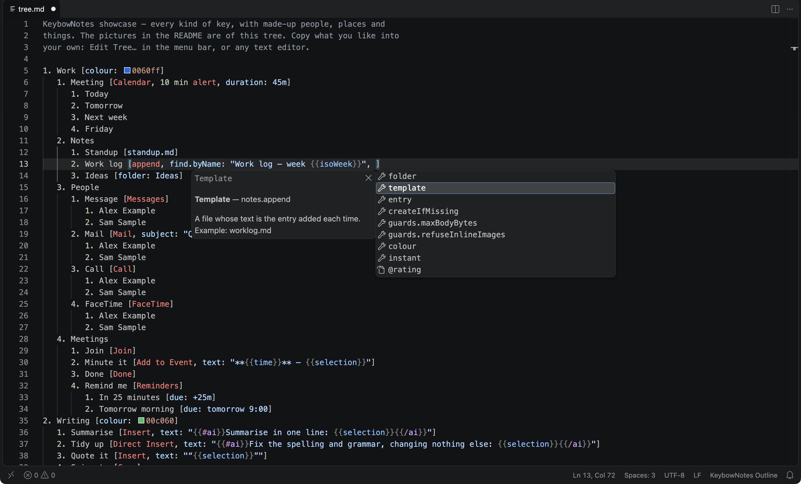

# KeybowNotes for VS Code

Colours and completion for KeybowNotes' outline — `tree.md` — and its
templates, in VS Code.



## What it does

- **Colours the outline as KeybowNotes reads it.** Key numbers, the last
  `[…]` group on a line and every item in it: action keywords (`Calendar`,
  `append`, `Copy`…), fields (`find.byName`, `duration`), values for templates
  (`area: work`), `@lists`, templates (`standup.md`), links, apps, alerts
  (`10 min alert`). Steps and their `If`, `Else if`, `Else`, with the test's
  words and signs. Section headings — `# row 2 [pages]`, `# list when`,
  `# keypad Desk [RGB Keypad]`, `# contacts`, `# defaults`. The preamble, and
  lines the outline ignores, show as comments.
- **Colours `{{values}}`** wherever they are: `{{leaf}}`, `{{date:EEEE d MMMM}}`,
  `{{contact.phone|none}}`, `{{quote file='quotes.md'}}`, `{{#each clipboard
  where="Paid = no"}}…{{/each}}`, `{{#ai}}…{{/ai}}`, values in values. In a
  template file the rest is Markdown, coloured as usual.
- **Completes what you type.** In a key's brackets: keywords, then the fields
  of the key's type — its own, or inherited from the branch above, or from
  where a `# list` is used — with what each takes: `format: auto|rich|plain`,
  `true`/`false`, action types, your templates, your apps. After `ok: Copy` on
  a display, `ok.text` and the rest. After `{{`: every value, with what it
  gives; after `{{#`, the blocks; after `{{/`, the one left open; after
  `{{date:`, formats; attributes and their choices. On a step: `If`, then
  `Else if` and `Else` after one, the values to test, and the tests —
  `contains`, `is not empty`, `>=`. Headings, keypad models, defaults and the
  fields of contacts and projects too.
- **Explains a word under the pointer**: an action's type and fields, a
  field's help, a value's meaning — the same text as the tree editor's tooltips.
- **Shows each colour** beside `colour: 0060ff`, with a picker to change it.

The words it knows come from the app itself (below), so they're the tree
editor's own.

## Telling KeybowNotes files from other Markdown

Outlines and templates are `.md` files, so VS Code opens them as Markdown. The
extension switches them to **KeybowNotes Outline** or **KeybowNotes Template**
— the status bar says which — by:

- **Where they are.** `tree.md` in a `KeybowNotes` folder, as the app keeps it
  in `~/Library/Application Support/KeybowNotes/`, and anything in that
  folder's `templates`. A file in any `templates` folder beside a `tree.md` is
  a template too.
- **What's in them**, for those anywhere else:
  - *An outline* is nearly all numbered keys, steps and sections, and says
    something only an outline says: an action keyword or field in brackets,
    `# row 2`, `# list …`, `If {{…}}`. A Markdown numbered list among
    paragraphs isn't one.
  - *A template* has KeybowNotes values — one of ours, like `{{leaf}}`,
    `{{selection}}`, `{{date:d MMM}}` or `{{@count}}`, or two more common
    ones — and nothing from another template language (`{{#if}}`,
    `{{ .Title }}`, ``). Values quoted as code, as in writing *about*
    the syntax — this repository's docs — don't count.

To keep a file as Markdown, choose Markdown from the status bar's language
picker: it stays Markdown until it's closed and opened again. To keep a whole
pattern as Markdown, a `files.associations` entry for it is respected. To stop
switching altogether, turn off **KeybowNotes › Detect: Outlines** or
**Templates** in Settings.

A template in KeybowNotes Template mode isn't Markdown to VS Code, so
Markdown's preview and outline don't apply to it; switch to Markdown for them.

## Installing

It isn't in the Marketplace. Build it and install the file:

```bash
cd vscode && npm install && npm run package
```

```bash
code --install-extension vscode/keybownotes-0.1.0.vsix
```

Or, in VS Code, *Extensions › … › Install from VSIX…* and choose the file.

## Working on it

- `npm test` — the completion, detection and grammar tests, through VS Code's
  own TextMate engine. The template grammar builds on VS Code's Markdown
  grammar, read from `/Applications/Visual Studio Code.app` (or
  `MARKDOWN_GRAMMAR`).
- `npm run test:vscode` — the same extension in VS Code itself: a window opens
  for a few seconds, on throwaway settings, and checks switching, completion,
  hovers, colours and the colours VS Code gives each token.
- `node test/tokenize.mjs outline ../docs/examples/showcase.md` — the scope
  of every piece of a file, for working on the grammars.
- `npm run vocabulary` — after adding an action type, a field or a value to the
  app: runs `keybow vocabulary`, which prints the language's words from the
  app's own descriptions, into `data/vocabulary.json`, and rebuilds the
  grammars from it (`npm run grammars` does only that).

`src/outline.js` reads the outline by the app's rules (`Outline.swift`),
`src/completion.js` works out what to offer, `src/detect.js` tells our files
from others, and `src/extension.js` connects them to VS Code.
